<!--
  Every panel ships in assets/dark/ and assets/light/; <picture> serves the one matching the
  viewer's GitHub theme. Text is drawn as outlines so it renders identically everywhere.
  Regenerate:  python assets/_render.py   ·   activity panel: assets/_stats_generator.py (nightly CI)
-->

<picture>
  <source media="(prefers-color-scheme: dark)" srcset="assets/dark/hero.svg">
  <source media="(prefers-color-scheme: light)" srcset="assets/light/hero.svg">
  
</picture>

<a href="https://www.linkedin.com/in/harshal-andhale/"><picture><source media="(prefers-color-scheme: dark)" srcset="assets/dark/btn-linkedin.svg"><source media="(prefers-color-scheme: light)" srcset="assets/light/btn-linkedin.svg"></picture></a>&nbsp;&nbsp;<a href="mailto:harshalandhale9@gmail.com"><picture><source media="(prefers-color-scheme: dark)" srcset="assets/dark/btn-email.svg"><source media="(prefers-color-scheme: light)" srcset="assets/light/btn-email.svg"></picture></a>&nbsp;&nbsp;<a href="https://github.com/HarshalAndhale9657?tab=repositories"><picture><source media="(prefers-color-scheme: dark)" srcset="assets/dark/btn-repos.svg"><source media="(prefers-color-scheme: light)" srcset="assets/light/btn-repos.svg"></picture></a>

  

<picture>
  <source media="(prefers-color-scheme: dark)" srcset="assets/dark/principles.svg">
  <source media="(prefers-color-scheme: light)" srcset="assets/light/principles.svg">
  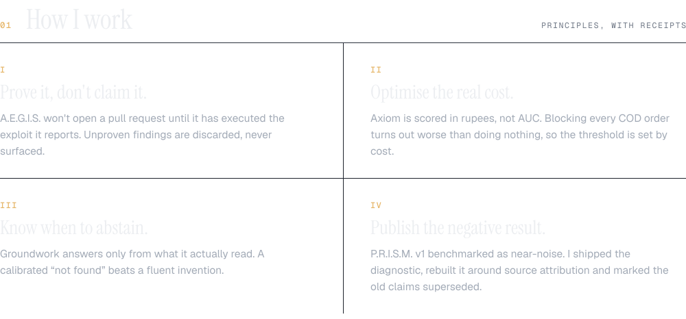
</picture>

  

<picture>
  <source media="(prefers-color-scheme: dark)" srcset="assets/dark/experience.svg">
  <source media="(prefers-color-scheme: light)" srcset="assets/light/experience.svg">
  
</picture>

  

<picture>
  <source media="(prefers-color-scheme: dark)" srcset="assets/dark/work.svg">
  <source media="(prefers-color-scheme: light)" srcset="assets/light/work.svg">
  
</picture>

<a href="https://github.com/HarshalAndhale9657/ANVIL"><picture><source media="(prefers-color-scheme: dark)" srcset="assets/dark/card-aegis.svg"><source media="(prefers-color-scheme: light)" srcset="assets/light/card-aegis.svg">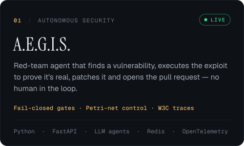</picture></a>
<a href="https://github.com/HarshalAndhale9657/P.R.I.S.M"><picture><source media="(prefers-color-scheme: dark)" srcset="assets/dark/card-prism.svg"><source media="(prefers-color-scheme: light)" srcset="assets/light/card-prism.svg">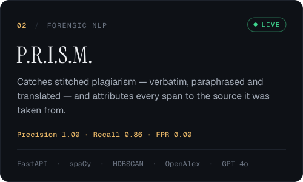</picture></a>
<a href="https://github.com/HarshalAndhale9657/Axiom"><picture><source media="(prefers-color-scheme: dark)" srcset="assets/dark/card-axiom.svg"><source media="(prefers-color-scheme: light)" srcset="assets/light/card-axiom.svg">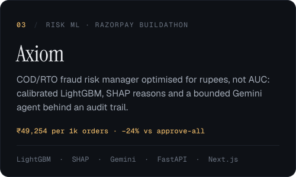</picture></a>
<a href="https://github.com/HarshalAndhale9657/LocalOS"><picture><source media="(prefers-color-scheme: dark)" srcset="assets/dark/card-groundwork.svg"><source media="(prefers-color-scheme: light)" srcset="assets/light/card-groundwork.svg">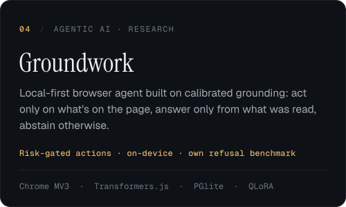</picture></a>
<a href="https://github.com/HarshalAndhale9657/OpenEnv"><picture><source media="(prefers-color-scheme: dark)" srcset="assets/dark/card-incidentforge.svg"><source media="(prefers-color-scheme: light)" srcset="assets/light/card-incidentforge.svg">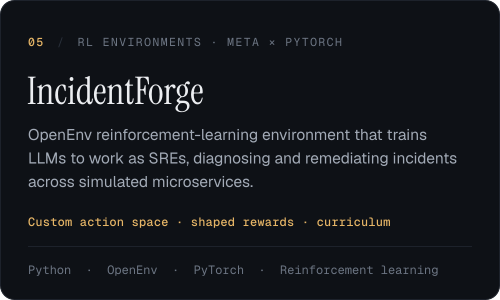</picture></a>
<a href="https://github.com/HarshalAndhale9657/Reconcillation-Engine"><picture><source media="(prefers-color-scheme: dark)" srcset="assets/dark/card-reconciliation.svg"><source media="(prefers-color-scheme: light)" srcset="assets/light/card-reconciliation.svg">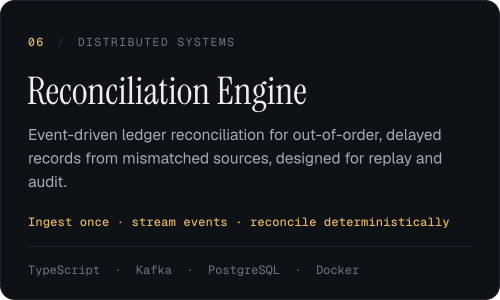</picture></a>

Live demos&nbsp; → &nbsp;<a href="https://aegis-frontend-azure.vercel.app"><b>A.E.G.I.S.</b></a> &nbsp;·&nbsp; <a href="https://p-r-i-s-m-psi.vercel.app/"><b>P.R.I.S.M.</b></a> &nbsp;·&nbsp; <a href="https://campus-lens-delta.vercel.app/"><b>CampusLens</b></a>

<b>More projects</b> &nbsp;·&nbsp; CampusLens, Second Brain, VEKTOR Studio, MediSense AI, LeakSense

 

| | |
|:--|:--|
| [**CampusLens**](https://github.com/HarshalAndhale9657/Campus-Lens) | Real-time 3D digital twin of a campus: React Three Fiber, live occupancy heatmaps, anomaly alerts and a RAG chatbot. The simulation layer swaps for real IoT sensors without touching the frontend. |
| [**Second Brain**](https://github.com/HarshalAndhale9657/SecondBrain) | A complete RAG pipeline running entirely in the browser: Transformers.js embeddings over PGlite + pgvector with HNSW. Nothing is uploaded. |
| [**VEKTOR Studio**](https://github.com/HarshalAndhale9657/VEKTOR) | Production site for a web design studio: hardened API routes, JSON-LD `ProfessionalService` schema, OG cards and sitemap. |
| [**MediSense AI**](https://github.com/HarshalAndhale9657/MediSense-AI) | Multimodal health assistant on GPT-4o Vision: medical-report decoding, drug-interaction checks and skin-condition analysis. |
| [**LeakSense**](https://github.com/HarshalAndhale9657/LeakSense-Dashboard) | IoT multi-gas leak detection: ESP32 → SQLite → Flask/Socket.IO at 1 Hz, with an offline watchdog and a hardware-free simulator. |

 

<picture>
  <source media="(prefers-color-scheme: dark)" srcset="assets/dark/recognition.svg">
  <source media="(prefers-color-scheme: light)" srcset="assets/light/recognition.svg">
  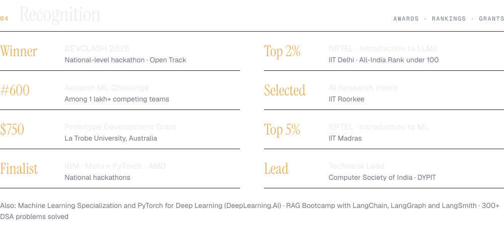
</picture>

  

<picture>
  <source media="(prefers-color-scheme: dark)" srcset="assets/dark/toolkit.svg">
  <source media="(prefers-color-scheme: light)" srcset="assets/light/toolkit.svg">
  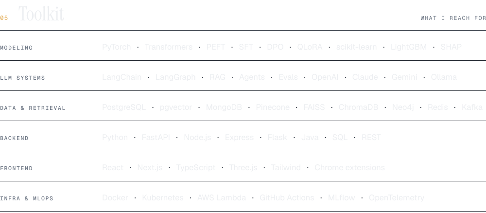
</picture>

  

<picture>
  <source media="(prefers-color-scheme: dark)" srcset="assets/dark/stats.svg">
  <source media="(prefers-color-scheme: light)" srcset="assets/light/stats.svg">
  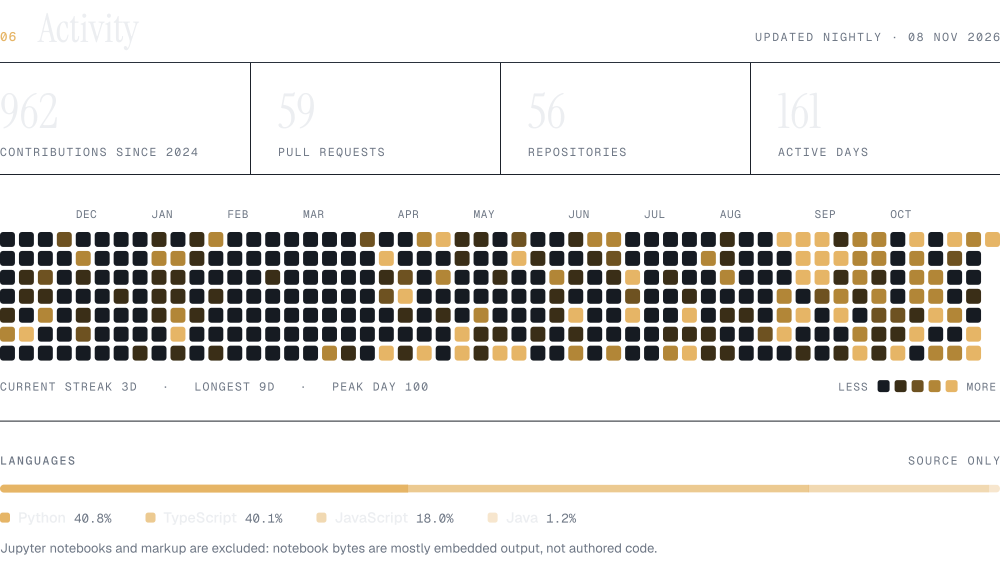
</picture>

   

<picture>
  <source media="(prefers-color-scheme: dark)" srcset="assets/dark/footer.svg">
  <source media="(prefers-color-scheme: light)" srcset="assets/light/footer.svg">
  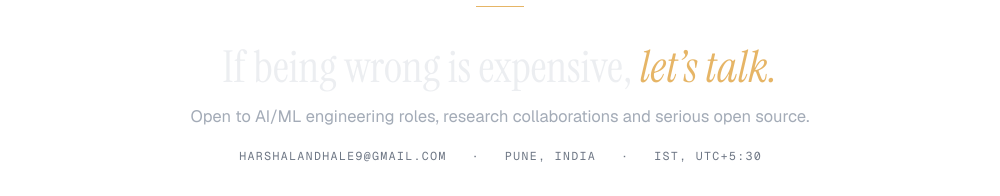
</picture>

<a href="https://www.linkedin.com/in/harshal-andhale/"><picture><source media="(prefers-color-scheme: dark)" srcset="assets/dark/btn-linkedin.svg"><source media="(prefers-color-scheme: light)" srcset="assets/light/btn-linkedin.svg"></picture></a>&nbsp;&nbsp;<a href="mailto:harshalandhale9@gmail.com"><picture><source media="(prefers-color-scheme: dark)" srcset="assets/dark/btn-email.svg"><source media="(prefers-color-scheme: light)" srcset="assets/light/btn-email.svg"></picture></a>

